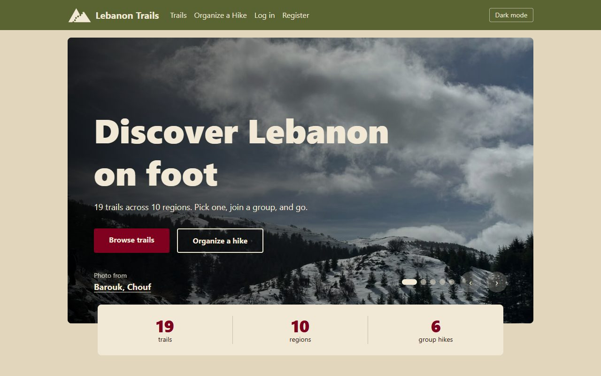
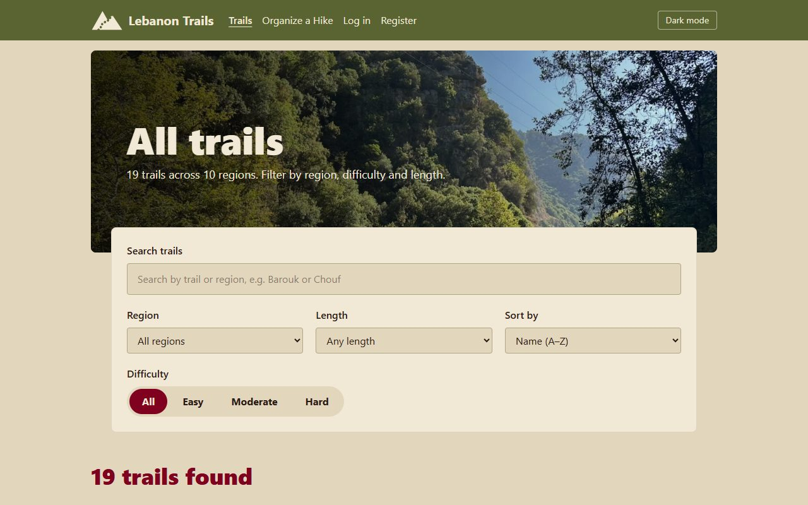
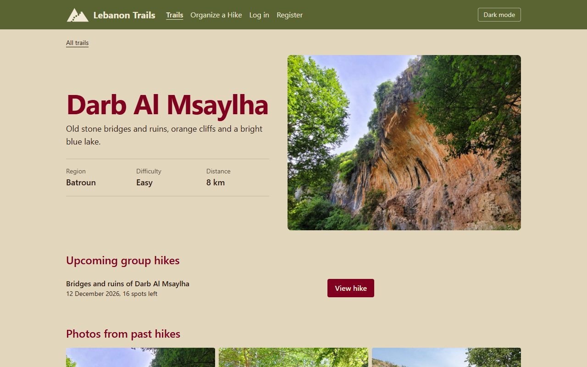
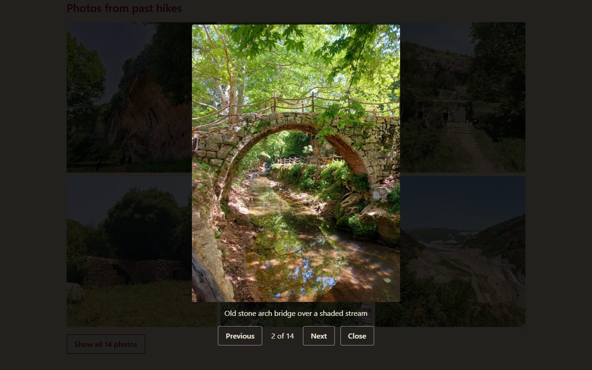
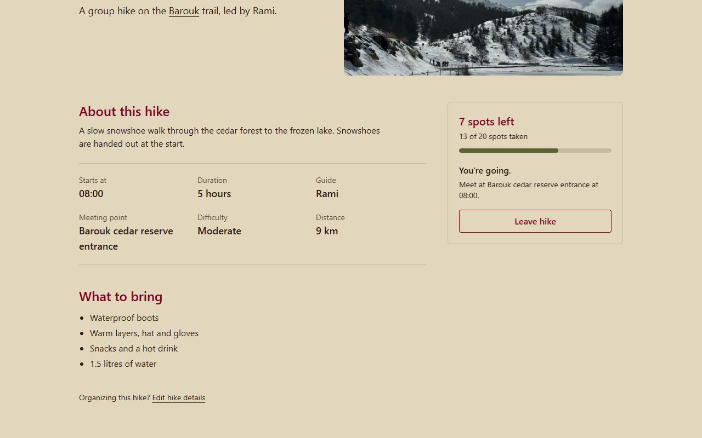
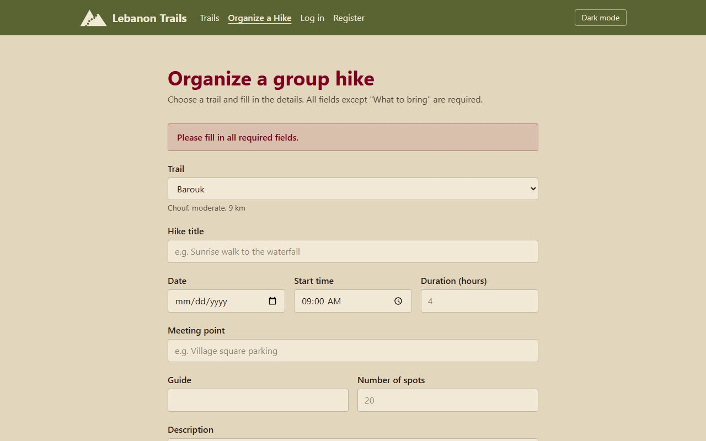
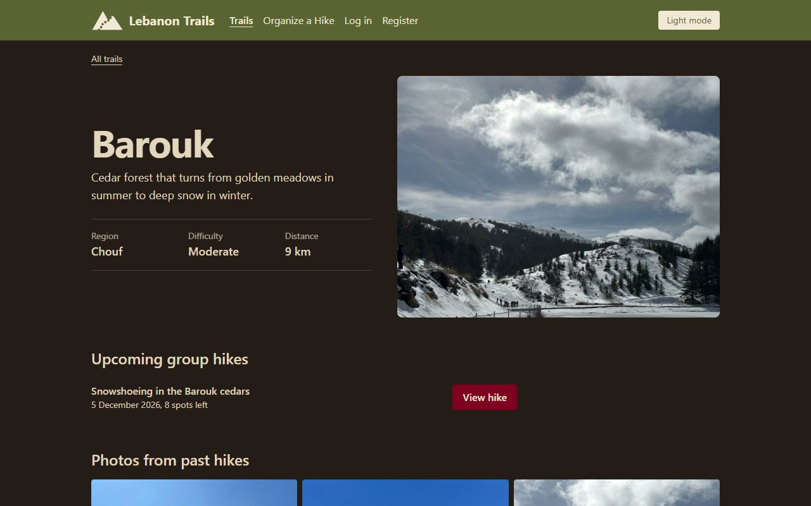
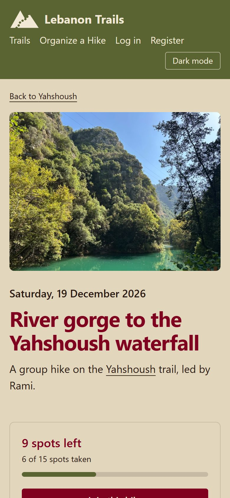

# Lebanon Trails

Lebanon Trails is a website that provides access to various hiking trips around Lebanon, providing comfort and maximizing hikers' enjoyment of the country's landscapes, from the northern mountains to the southern coast.

## Features
- Browse 19 trails across Lebanon, with photos from past hikes
- Trail pages with region, difficulty, distance and a full-screen photo gallery
- Join or leave upcoming group hikes, with live spots-left counts
- Organize a new group hike or edit an existing one
- Light and dark mode, on phone, tablet and desktop

**Live site:** https://lebanon-trails-team.surge.sh
**Repository:** https://github.com/Doha-gitt/lebanon-trails

## Team
- Doha Sanaknaki
- Sarah Ghanawi
- Tala Daouk

## Topic and data entities
Topic: Lebanon Trails & Group Hikes
Main entities: **Trails**, **Group Hikes**, **Users**.

- **Trail:** name, region, difficulty, distance, description, cover photo and a gallery of photos from past hikes.
- **Group hike:** the trail it takes place on, title, date, start time, meeting point, duration, guide, number of spots (total and taken), description and what to bring.
- **User:** an account used by the Login and Register forms.

## Built with
- React (functional components and hooks) with Vite
- Tailwind CSS v4, with the team colours defined in `src/index.css`
- React Router for navigation between pages
- Git and GitHub, with one branch per feature merged through pull requests

## Running it locally
1. Install Node.js (version 20.19 or newer).
2. `git clone https://github.com/Doha-gitt/lebanon-trails.git`
3. `cd lebanon-trails`
4. `npm install`
5. `npm run dev`, then open the link it shows (usually http://localhost:5173).

Opening `index.html` directly in the browser shows a blank page. The site must be started with `npm run dev`.

To try logging in, use the demo account **doha@example.com** with password **trails123**, or register a new account. Accounts and changes reset when the page is refreshed.

## Screenshots

**Trail list:** search with suggestions, and filters for region, length and difficulty.

**Trail page:** cover photo, trail details and upcoming group hikes.

**Photos from past hikes:** clicking a photo opens a full-screen viewer.

**Group hike page:** after joining, the spots-left count goes down and the meeting details are shown.

**Organize a hike:** the form checks every field before the hike is published.

**Dark mode**

**On a phone**

## Pages and contributions
- **Doha:** Trail Detail and Group Hike Detail.
  - Trail Detail shows each trail's cover photo, region, difficulty and distance, its upcoming group hikes, and a gallery of photos from past hikes with a full-screen photo viewer.
  - Group Hike Detail shows a hike's date, time, meeting point, guide and what to bring, with a Join button that updates the number of spots left across the site.
  - Also provided the trail photos (93 photos from 19 places), and set up the project skeleton, routes, colour theme, logo and the shared hike data used by several pages.
- **Sarah:** Home and Trail List.
  - Home has a photo slider of featured trails, a difficulty picker that shows matching trails, a grid of regions, the next upcoming group hikes, and hiking tips that can be shown or hidden.
  - Trail List: shows all trails as photo cards with their difficulty and length. A search box suggests matching trails and regions while you type, and visitors can filter by region, difficulty and length, sort by name or distance, and clear all filters at once. A message appears when no trail matches.
- **Tala:** Login, Register, and the Organize/Edit Hike form.
  - Login Page is an interactive user authentication view built with client-side state handling and input validation. It validates email formats and non-empty inputs, then checks the email and password against the mock user accounts before logging the user in and redirecting to the trail list. The navbar then shows the user's name and a Log out button.
  - Register Page is a new user onboarding interface that collects user credentials with real-time field validation. It verifies that all fields are populated, validates proper email formatting, ensures passwords meet a minimum character length, checks for matching password confirmations, rejects an email that is already registered, and appends the new account to local mock state before redirecting to login.
  - Organize Hike Form is a dynamic form component that handles publishing new community hikes and editing existing ones. It features comprehensive client-side validation including numerical bounds on duration and number of spots and calendar restrictions preventing past date selection, and updates the shared mock hikes array so the hike instantly appears on its own page, its trail's page and the home page.

## How mock data is used
There is no backend or database. All data lives in the browser:

- **Trails and group hikes** are JavaScript arrays in `src/data/mockData.js`. Trail photos are stored in `public/images/trails/`.
- **Group hikes are kept in React state** through a shared context (`useHikes()` in `src/context/HikesContext.js`), so every page reads the same up-to-date list.
- **Joining or leaving a hike** changes its number of spots taken in that state. The new count appears straight away on the hike page, the trail page and the home page.
- **The Organize/Edit form** adds a new hike or saves changes to an existing one in the same state (`addHike` and `updateHike`), so the hike then appears on the other pages.
- **Login and Register** check and add accounts in a mock list of users (`users` in `src/data/mockData.js`, kept in React state through `useAuth()` in `src/context/AuthContext.js`). The navbar then shows who is logged in.
- **Light or dark mode** is the only setting kept after a refresh (saved in the browser's local storage).

Everything else resets when the page is refreshed. The site only *appears* to save changes, as the project brief requires.

## Use of AI tools
- Our team used AI tools, including Claude (an AI assistant), to help write and improve the code, and for the colour theme and the page styling. We chose the content, photos, design and features, and reviewed and tested the results.

